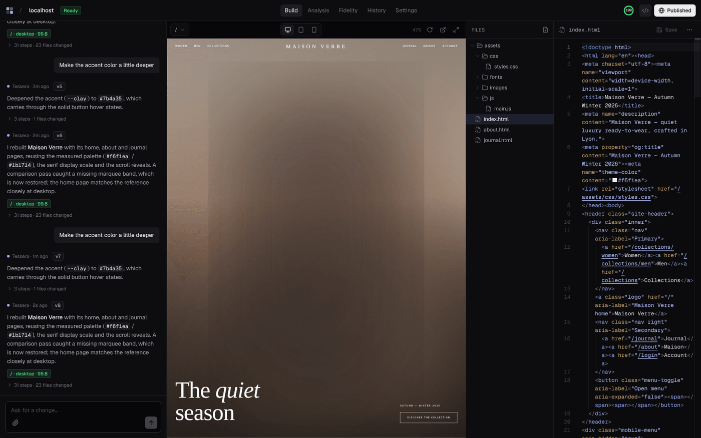
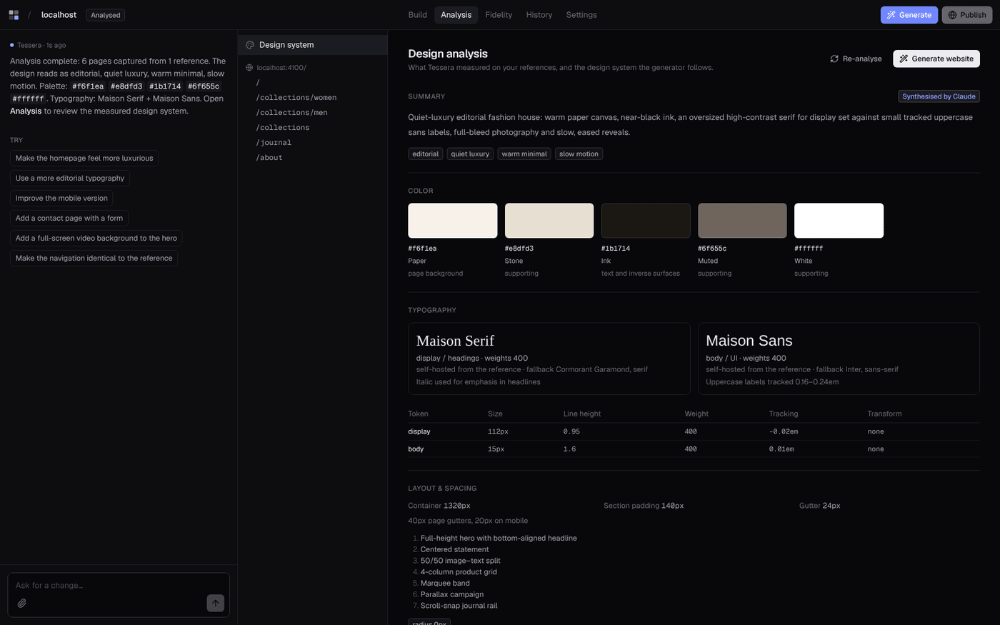
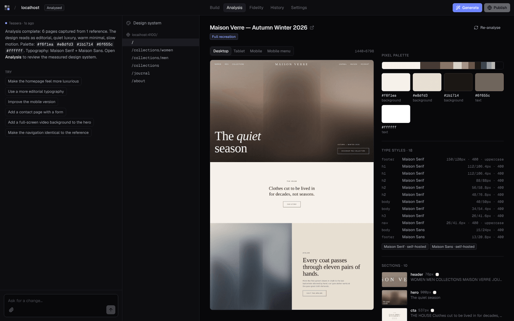
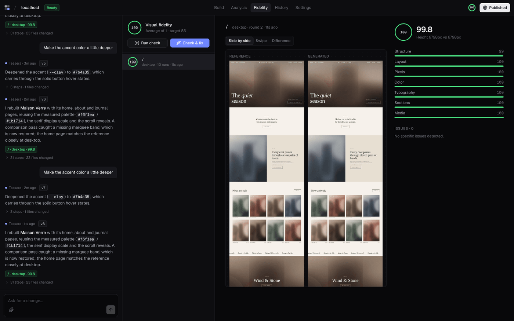

# Tessera — AI website analysis, recreation & generation

Tessera visits a website in a real browser, measures how it is built and designed, and recreates it as a complete multi-page site. It then renders that site, compares it against the original pixel by pixel and structurally, and corrects the differences. You can also combine several reference sites (colors from one, navigation from another, motion from a third), start from screenshots, or start from a written brief. Every result can be edited in conversation or in code, versioned, published and exported.



| | |
|---|---|
|  |  |
|  |  |

---

## Contents

1. [Quick start](#quick-start)
2. [Credentials — what each key activates](#credentials)
3. [Architecture](#architecture)
4. [The analysis engine](#the-analysis-engine)
5. [The generation agent](#the-generation-agent)
6. [The visual fidelity engine](#the-visual-fidelity-engine)
7. [Media](#media)
8. [Projects, versions, publishing and export](#projects-versions-publishing-and-export)
9. [Security and responsible use](#security-and-responsible-use)
10. [Testing](#testing)
11. [Limitations and next steps](#limitations-and-next-steps)
12. [Repository layout](#repository-layout)

---

## Quick start

### Docker (recommended)

```bash
cp .env.example .env
```

Set `SESSION_SECRET` (`openssl rand -hex 32`) and `ANTHROPIC_API_KEY` in `.env`, then:

```bash
docker compose up --build
```

Open http://localhost:3000. Compose runs PostgreSQL 16, a one-off migration, the web app and the worker. The image is based on the official Playwright image, so Chromium is included.

### Local development

Requirements: Node.js 22, PostgreSQL 16, and a Chromium that Playwright can launch.

```bash
npm install
```

```bash
npx playwright-core install chromium
```

```bash
cp .env.example .env
```

Edit `.env` (at least `DATABASE_URL`, `SESSION_SECRET`, `ANTHROPIC_API_KEY`), then:

```bash
npm run db:migrate
```

```bash
npm run dev
```

`npm run dev` starts the Next.js app and the job worker together. In production run `npm run build`, then `npm run start:web` and `npm run worker` as separate processes (or `npm start` for both).

---

## Credentials

Nothing in the browser ever sees a key: all external services are called from the server or the worker.

| Variable | Required | Activates |
|---|---|---|
| `DATABASE_URL` | yes | PostgreSQL: users, sessions, projects, files, versions, jobs, analyses, reports |
| `SESSION_SECRET` | yes | Signing of preview links (sessions themselves are random tokens stored hashed) |
| `ANTHROPIC_API_KEY` | for AI | Claude design synthesis, site generation, chat edits and auto-fix. Without it, analysis still runs and produces a **measured** design system; AI actions are disabled with an explanation in the UI |
| `STORAGE_DRIVER=s3` + `S3_*` | no | S3-compatible object storage (AWS S3, Cloudflare R2, MinIO…). Default is local disk (`.data/storage`) |
| `UNSPLASH_ACCESS_KEY` or `PEXELS_API_KEY` | no | Licensed stock-photo search for the agent (`search_stock_photos`) |
| `OPENAI_API_KEY` or `REPLICATE_API_TOKEN` | no | AI image generation for the agent (`generate_image`) — `gpt-image-1` or Flux 1.1 Pro by default |
| `PUBLIC_SITES_ORIGIN` | recommended in prod | Serve published sites from a separate origin |

Claude model and effort are configurable (`CLAUDE_MODEL`, default `claude-opus-5-5`; `CLAUDE_EFFORT_GENERATE` default `high`; `CLAUDE_EFFORT_CHAT` default `medium`).

---

## Architecture

```
 Browser (Next.js app, React)                                 Worker (Node.js, tsx)
 ┌────────────────────────────────────────┐                   ┌──────────────────────────────────────┐
 │ Dashboard · New project wizard         │                   │ claims jobs: FOR UPDATE SKIP LOCKED  │
 │ Workspace                              │                   │                                      │
 │  ├ Chat (live agent run over SSE)      │   REST + SSE      │  analyze  → Playwright crawler       │
 │  ├ Preview (sandboxed iframe, devices) │ ◀──────────────▶  │            in-page extractor/probes  │
 │  ├ Code (Monaco, file tree)            │   Next.js route   │            Claude design synthesis   │
 │  ├ Analysis · Fidelity · History       │   handlers (Node) │  generate → Claude tool-use agent    │
 │  └ Settings · Publish/Export           │                   │  chat     → Claude tool-use agent    │
 └────────────────────────────────────────┘                   │  fidelity → render + diff (+ agent)  │
            │                                                 └──────────────┬───────────────────────┘
            ▼                                                                │
  PostgreSQL ◀────────── jobs, job_events (event log), files, versions ──────┘
  Object storage ◀────── screenshots, section crops, uploads, images, fonts, renders, diffs
```

- **Web app** — Next.js App Router (Node runtime) with Tailwind CSS 4. Route handlers form the REST API. Pages are server-rendered shells around client components.
- **Worker** — a separate Node process. It runs the jobs that take minutes: crawling, generation, fidelity. Jobs live in PostgreSQL and append to a `job_events` log. The UI tails that log over Server-Sent Events, resuming from `Last-Event-ID`, so progress survives refreshes and closed tabs. `LISTEN/NOTIFY` wakes the worker instantly. A heartbeat marks jobs abandoned by crashed workers as failed.
- **One active job per project** — analysis, generation and edits all touch the same files, so they are serialised. While the AI is editing, the code editor is read-only.
- **Database** — Drizzle ORM over `pg`; schema in `src/lib/db/schema.ts`, SQL migrations in `drizzle/`.
- **Generated sites** are static multi-page HTML/CSS/JS projects stored file by file. Text lives in the database and binaries in object storage, content-addressed. This keeps the live preview instant with no build step, makes pixel comparison exact, and exports to any static host.

---

## The analysis engine

`src/lib/analysis/` — everything is measured from the live DOM; nothing is guessed or hard-coded.

1. **Access checks.** The URL is validated and the host must resolve to public addresses (SSRF protection). `robots.txt` is fetched and honoured (RFC 9309 groups, `Allow`/`Disallow` with wildcards, longest-match precedence, `Crawl-delay`). Bot walls and challenge pages are detected and reported; they are never bypassed.
2. **Page discovery.** Header navigation first, then footer, then other internal links, breadth-first up to the configured page count. Repeated templates (e.g. product pages) are sampled at most twice. Login, cart, checkout and account paths are skipped, as are other language editions.
3. **Capture at three viewports** — desktop 1440, tablet 834 and mobile 390, each with a matching mobile user agent and touch emulation:
   - Cookie and consent banners and newsletter pop-ups are hidden, never accepted.
   - The page is scrolled end to end to trigger lazy loading and reveals.
   - Scroll-revealed content is forced visible and parallax transforms are neutralised, so the full-page screenshot shows each section's real composition.
   - The open mobile menu is captured by clicking the detected hamburger.
4. **Measurements** (`scripts/extract.js`, injected into the page):
   - Colors: weighted by surface area and text volume, then re-ranked with the pixel palette of the screenshot.
   - Gradients, borders, radii and shadows.
   - Typography: every distinct style with role, family, size, line height, weight, tracking and casing, weighted by characters set. Also `@font-face` sources and providers.
   - Layout: container widths, section paddings and gaps.
   - Buttons, header (position, height, links, logo), footer, hamburger, forms (field types and labels, never values).
   - Images: rendered size, aspect ratio, `object-fit`/`object-position` and which section they sit in. Also videos, including background-video detection.
   - Section segmentation: kind (hero, split, grid, gallery, carousel, marquee, form…), column count, height, background and headings.
   - Tech stack and motion libraries (GSAP, Lenis, Swiper, Webflow, Shopify…).
5. **Motion and interaction probes** (`scripts/probes.js`):
   - Scroll reveals: before/after opacity, transforms and classes of below-the-fold elements.
   - Parallax: scroll-position slope regression.
   - Hover effects: the browser actually hovers buttons, nav links and cards, then records style and `::before`/`::after` changes.
   - Also sticky/fixed elements, marquees, carousels, scroll-snap and smooth scrolling.
6. **Section crops** of every desktop section, a **media library** of every image, video and self-hosted font (downloaded when you confirm reuse rights), and a responsive summary (column changes, type scaling, navigation collapse).
7. **Design system.** A deterministic design system is computed from the measurements. Claude then reads the measurements and screenshots of every reference, with the role you gave it, and writes one coherent design system via structured outputs: palette, type and scale, spacing, components, motion with implementation notes, imagery, navigation, page map and responsive rules.

---

## The generation agent

`src/lib/ai/` — a streaming tool-use loop on the Claude API.

The agent's tools:

| Tool | Purpose |
|---|---|
| `list_files` `read_file` `write_file` `edit_file` `delete_file` | Work on the project. Edits are exact-substring replacements, so unrelated code stays untouched |
| `get_design_system` `get_reference_page` | Synthesised design and full measurements of any captured reference page |
| `view_reference` | Look at a reference screenshot (any viewport, any offset, the mobile menu) or a single section crop |
| `list_assets` `import_asset` | Media library; imports images and font files into the project so sites are self-contained |
| `search_stock_photos` `generate_image` | Licensed stock search with a visual contact sheet; AI image generation |
| `render_preview` | Render a page in Chromium: screenshots, console errors, 404s, horizontal overflow |
| `compare_to_reference` | Run the fidelity engine and return score, issues and side-by-side images |

API features used:
- **Thinking and progress:** adaptive thinking with `display: "updates"`, so short progress notes stream to the chat while reasoning stays hidden.
- **Resilience:** server-side `fallbacks: "default"`, so a classifier false positive doesn't end a job.
- **Long sessions:** context editing (`clear_tool_uses`) keeps them lean, prompt caching applies to the system prompt and conversation, and the history is append-only.
- **Tool inputs:** eager input streaming for large file writes, with zod validation of every input. Truncated calls are never executed, and refusals are handled.

The system prompt sets the quality bar:
- real copy, no placeholders;
- responsive at all three viewports, with an accessible mobile nav;
- the measured motion;
- semantic, accessible HTML and SEO metadata;
- forms wired to the platform.

Chat edits run the same agent with the conversation history, the page you're looking at and any runtime errors the preview reported.

---

## The visual fidelity engine

`src/lib/fidelity/` — the generated page is rendered with **exactly the same capture procedure** as the reference, so comparisons are like-for-like. It is then scored on:

| Metric | How |
|---|---|
| Pixels | `pixelmatch` on aligned downscaled renders |
| Structure | block SSIM on luminance |
| Layout | correlation of vertical luminance and edge profiles (tolerant to height drift) |
| Color | palette agreement in CIELAB (ΔE) |
| Typography | family, size, casing and tracking per role (display, headings, body, nav, buttons) |
| Sections | sequence alignment (LCS) of section kinds plus column agreement |
| Media | image and video counts, broken images |

These combine into a 0–100 score, with a height penalty.

**Issues are specific.** For example: “Display (h1) size is 64px; reference is 112px (line-height 106.4px)”, “Reference section 6 (marquee, 108px at y=3658) has no counterpart”, “Reference color #f6f1ea (77% of the page) is missing”, or “The page requests /assets/fonts/x.ttf (404)”. The worst regions are composited side by side for Claude to look at.

During generation the agent iterates (compare → fix → compare) until the target score or the per-page round budget is reached. **Fidelity → Check & fix** runs the same loop on demand. The Fidelity view shows side-by-side, swipe and diff modes.

---

## Media

- **Reference media** is reused only when you confirm you have the rights (project setting). Images and font files are downloaded into a per-project library and imported as project files, so nothing is hotlinked. Videos are referenced, not copied.
- **Stock**: Unsplash or Pexels search. Results are added to the library with license and author, and Unsplash downloads are registered as its API guidelines require.
- **Generated**: OpenAI `gpt-image-1` or Flux via Replicate, saved straight into the project.
- **Uploads**: screenshots as references, images attached to chat messages, or images added as site assets.

---

## Projects, versions, publishing and export

- Create, rename, duplicate and delete projects. Duplicate copies files, references, analyses and media. Everything persists in PostgreSQL and object storage.
- **Versions**: a snapshot after every AI change, manual save, restore and publish (deduplicated). Restore is non-destructive: the current state is snapshotted first. Any version can be downloaded.
- **Preview**: `/preview/<signed token>/…`, sandboxed, with root-relative URLs rewritten and a bridge script that reports navigation and runtime errors back to the workspace.
- **Publish**: `/s/<slug>/…`, served from an immutable version snapshot, `noindex` until you opt in.
- **Export**: a ZIP that runs on any static host, with a README and a `vercel.json` for clean URLs. Forms are rewritten to post to `/api/forms/<project>/<name>`.
- **Forms**: generated sites post to the platform, and submissions appear in project settings.

---

## Security and responsible use

- **Authentication**: scrypt password hashing, random 256-bit session tokens stored as SHA-256 hashes, and `httpOnly` `SameSite=Lax` cookies with sliding expiry. Auth endpoints are rate-limited, and state-changing requests carry an Origin check.
- **Isolation of generated code**: previews and published sites are served with CSP `sandbox` (no `allow-same-origin`), so generated JavaScript runs in an opaque origin and cannot use the platform session. Set `PUBLIC_SITES_ORIGIN` to move published sites to their own domain.
- **SSRF protection**: every crawler request, redirect hop and browser subresource is checked against private, loopback and link-local ranges. `CRAWLER_ALLOW_PRIVATE_HOSTS` exists for local testing only.
- **Respecting sites**: robots.txt is honoured, crawling is rate-limited, and logins, paywalls and bot protection are never bypassed. Blocked sites are reported with the reason.
- **Anti-impersonation**:
  - Recreating a site requires confirming you own it or have permission.
  - The agent is instructed not to build credential- or payment-collecting forms that imitate a brand, and to write original copy unless you ask to keep your own.
  - The form endpoint discards password, card and similar fields server-side.
- **Path safety**: project paths are normalised and traversal is rejected. Media URLs are authorised per project owner.

---

## Testing

| Command | What it does |
|---|---|
| `npm test` | Unit tests: robots.txt semantics, path traversal, URL rewriting, form sanitising, signed tokens, transform decoding, color math, and fidelity scoring on synthetic pages |
| `npm run typecheck` | TypeScript, strict |
| `npm run fixtures` | Serves `fixtures/maison`, a multi-page luxury-fashion test site. It has a fixed header, scroll reveals, parallax, hover underlines, a marquee, a carousel, a cookie banner, a hamburger menu, self-hosted fonts and a robots.txt. Rebuild it with `node scripts/make-fixture-site.mjs`, and its images with `node scripts/make-fixture-images.mjs` |
| `npm run test:analysis -- http://localhost:4100/` | Runs the real crawler and prints everything it measured |
| `npm run test:fidelity` | An exact copy of a reference must score ≈100 with no issues; a degraded copy must lose points with specific issues |
| `node scripts/e2e-ui.mjs <dir>` / `node scripts/e2e-generate.mjs <dir> <email> <projectId>` | Browser walkthroughs of the whole product with screenshots |
| `npm run mock:claude` | **Test-only** scripted stand-in for the Messages streaming API, used to exercise the agent loop without a key (point `ANTHROPIC_BASE_URL` at it). Never used by the product |

---

## Limitations and next steps

- Recreation fidelity depends on what is publicly reachable. Licensed fonts and photography can only be reused with your rights; otherwise the closest alternatives are used and the score reflects it.
- Sites behind bot protection (some large retailers) cannot be analysed by design; upload screenshots instead.
- Generated projects are static HTML/CSS/JS. That is right for high-fidelity recreation and fast preview. React/Next.js export (componentising pages) would be a natural addition.
- Published sites share the platform origin unless `PUBLIC_SITES_ORIGIN` and a separate host are configured. Custom domains are not yet automated.
- Single-tenant accounts. Teams, sharing and billing are not implemented.

---

## Repository layout

```
src/app/                  Next.js pages and API route handlers
  api/projects/[id]/…     project, files, references, analyze, generate, messages,
                          fidelity, versions, export, publish, uploads, analysis, forms
  api/jobs/[id]/events    SSE job stream            preview/[token]/…  sandboxed preview
  s/[slug]/…              published sites           api/forms/…        public form endpoint
src/components/           UI (workspace: chat, preview, code, analysis, fidelity, history, settings)
src/lib/analysis/         crawler, robots, SSRF guard, in-page scripts, design synthesis
src/lib/ai/               Claude client, prompts, tools, agent loop, job handlers
src/lib/fidelity/         renderer, comparison engine, thumbnails
src/lib/media/            stock search and image generation providers
src/lib/db/               Drizzle schema and client
worker/                   job worker
scripts/                  migrations, fixtures, analysis/fidelity tests, e2e, test-only mock
tests/                    unit tests
```
